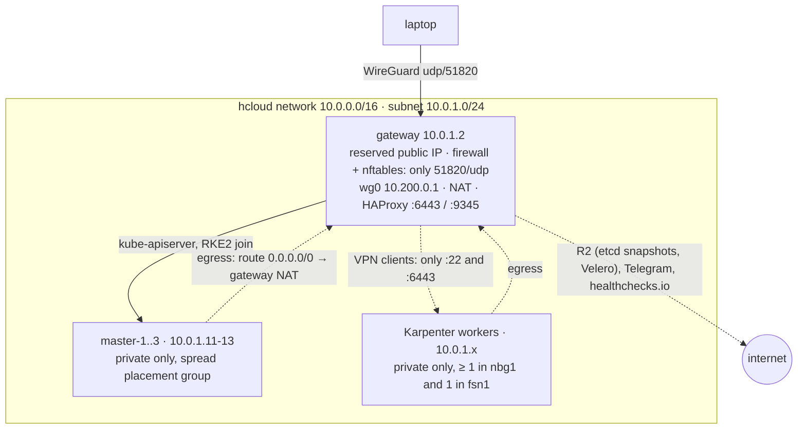

# hetzner-cloud

RKE2 Kubernetes cluster on Hetzner Cloud:

- 3 RKE2 server (control-plane + etcd) nodes managed by Terraform
- Worker nodes provisioned on demand by [Karpenter](https://karpenter.sh) using the
  community [Hetzner provider](https://github.com/stubbi/karpenter-provider-hetzner)
- A private network — **no cluster node has a public IP**
- A WireGuard gateway as the only public host (VPN entry + NAT for egress)
- Production basics: Pod Security `baseline`, pods blocked from the metadata service,
  etcd snapshots and Velero backups to Cloudflare R2, Prometheus with Telegram
  alerts and a dead man's switch, a two-worker floor across locations, and kured
  for patch reboots

The git history builds the project one piece at a time — `git log --reverse -p` reads like a walkthrough.

Detailed documentation (in Portuguese) lives in [`docs/`](docs/README.md): architecture, the reason
for each piece of the stack, runbooks, security notes and [ADRs](docs/adr/README.md).

## Architecture



| Piece | Where |
|---|---|
| Network, routes | `terraform/infra/network.tf` |
| VPN/NAT gateway | `terraform/infra/gateway.tf`, `templates/gateway-cloud-init.yaml.tftpl` |
| Control-plane endpoint (HAProxy) | `templates/gateway-cloud-init.yaml.tftpl` |
| Masters, CCM + CSI | `terraform/infra/masters.tf`, `templates/master-cloud-init.yaml.tftpl` |
| Default route for private-only servers | `templates/private-network.sh.tftpl` |
| Worker bootstrap (Karpenter userData) | `templates/worker-userdata.yaml.tftpl` |
| Masters' RKE2 drop-ins (Pod Security, etcd-s3, metrics) | `templates/master/`, pushed by `scripts/sync-masters.sh` |
| Karpenter, NodeClass, NodePool, Traefik LB, external-dns, cert-manager | `terraform/cluster/` |
| Worker floor, kured | `terraform/cluster/capacity.tf`, `kured.tf` |
| Metadata block (Calico tier) | `terraform/cluster/metadata-guard.tf` |
| R2 buckets + scoped Cloudflare tokens, etcd-s3 Secret | `terraform/cluster/etcd-snapshots.tf`, `dns-token.tf`, `velero.tf` |
| Monitoring, Velero | `terraform/cluster/monitoring.tf`, `velero.tf` |

Two Terraform roots: `infra` talks only to the Hetzner API; `cluster` talks to
Kubernetes and therefore runs **over the VPN**.

## Prerequisites

`terraform` ≥ 1.10, `wireguard-tools` (or the WireGuard app), `jq`, `kubectl`, `helm`,
`aws` CLI, a Hetzner Cloud project and a **read/write** API token.

**Remote state** lives in the Cloudflare R2 bucket `rke2-tfstate` (S3 backend,
locking via `use_lockfile`; see `terraform/*/backend.tf`). Create an R2 API token
with **Object Read & Write scoped to that bucket only**, then:

```bash
aws configure --profile r2     # access key + secret of the R2 token, region "auto"
```

**Cloudflare provisioning token**: `terraform/cluster` creates its own R2 buckets
and scoped account tokens (etcd snapshots, Velero, DNS). Create one account API token
with *Account > Workers R2 Storage: Edit*, *Account > Account API Tokens: Edit*
and *Zone > Zone: Read* on the managed zones, and set it as
`cloudflare_provisioning_api_token` in `terraform/cluster/terraform.tfvars`.
It stays on your machine; the cluster only ever gets the narrow tokens.

**Alerts**: create a Telegram bot with @BotFather and send it a message (the bot
only learns a chat ID after one), then set `telegram_bot_token` (the whole
`<id>:<secret>`) and `telegram_chat_id` (from `getUpdates`). Optionally set
`deadmans_switch_url` to a healthchecks.io ping URL with a period ≥ 5 min:
without it, a dead gateway silences every alert.

## Bootstrap

```bash
# 1. Infrastructure
cd terraform/infra
cp terraform.tfvars.example terraform.tfvars   # set hcloud_token + ssh_public_key
terraform init && terraform apply -var gateway_sync=false   # first apply only: no VPN yet

# 2. VPN
mkdir -p ../../wg
terraform output -json vpn_client_configs | jq -r .laptop > ../../wg/laptop.conf
sudo wg-quick up ../../wg/laptop.conf          # or import into the WireGuard app
ping 10.0.1.11
( cd terraform/infra && terraform apply )   # enables the fail-closed gateway sync

# 3. Kubeconfig (pins the masters' host keys through the gateway, waits for RKE2)
../../scripts/get-kubeconfig.sh
export KUBECONFIG=$PWD/../../kubeconfig
kubectl get nodes                               # 3 masters, NotReady/uninitialized is expected

# 4. In-cluster: hcloud secret (unblocks CCM/CSI), Karpenter, NodePool, R2 buckets
#    and tokens, monitoring, Velero, kured, worker floor
cd ../cluster
cp terraform.tfvars.example terraform.tfvars   # Cloudflare, Telegram, zones, ACME email
terraform init && terraform apply
../../scripts/backup-state.sh
```

After step 4 the CCM initialises the masters (`spec.providerID: hcloud://…`) and
Karpenter starts serving pending pods.

## Verify

```bash
kubectl get nodes -o wide                       # masters Ready, INTERNAL-IP only
kubectl get nodes -o jsonpath='{.items[*].spec.providerID}'
kubectl get hcloudnodeclass default             # READY=True

# Scale-up test
kubectl create deployment inflate --image=registry.k8s.io/pause:3.10 --replicas=5
kubectl set resources deployment inflate --requests=cpu=1
kubectl get nodeclaims -w                       # new servers appear and join

# Scale-down test
kubectl delete deployment inflate               # consolidation removes the extra workers after ~5m

kubectl -n capacity get pods -o wide            # one placeholder per location keeps 2 workers
kubectl -n monitoring get pods                  # Prometheus, Alertmanager, Grafana
kubectl -n velero get backupstoragelocation     # PHASE=Available
kubectl get etcdsnapshotfiles                   # local and s3:// entries
```

From outside the VPN only `udp/51820` on the gateway should answer.

## Public ingress

RKE2's bundled Traefik is exposed through a public Hetzner Load Balancer
(lb11, US$7.89/mo; see [docs/costs.md](docs/costs.md)) that the hcloud CCM creates from the Traefik Service
(`terraform/cluster/ingress.tf`). The LB reaches Traefik over the private
network and uses PROXY protocol with `externalTrafficPolicy: Local`, so apps
see real client IPs.

```bash
kubectl apply -f examples/whoami.yaml
curl https://whoami.devcomm.com.br/  # echoes the request, incl. X-Real-Ip
# before DNS propagates, hit the LB directly:
IP=$(kubectl -n kube-system get svc rke2-traefik -o jsonpath='{.status.loadBalancer.ingress[0].ip}')
curl --resolve whoami.devcomm.com.br:80:$IP http://whoami.devcomm.com.br/
```

### TLS (cert-manager → Let's Encrypt, DNS-01 on Cloudflare)

cert-manager (`terraform/cluster/cert-manager.tf`) provides two ClusterIssuers,
`letsencrypt-staging` and `letsencrypt-prod`, that solve DNS-01 through
Cloudflare with the same Terraform-managed DNS token as external-dns, for the zones in
`external_dns_domains`. Set `acme_email` in `terraform.tfvars`. To get a
certificate, annotate the Ingress and add a `tls` block:

```yaml
metadata:
  annotations:
    cert-manager.io/cluster-issuer: letsencrypt-prod   # try staging first
spec:
  tls:
    - hosts: [app.example.com]
      secretName: app-tls
```

```bash
kubectl get certificate -A                        # READY=True once issued
```

Hosts without a certificate get Traefik's self-signed default.

### DNS (external-dns → Cloudflare)

external-dns (`terraform/cluster/external-dns.tf`) creates A/AAAA records for
every Ingress host inside `external_dns_domains`, pointing at the LB's public
IPs. Terraform creates its Cloudflare token (`terraform/cluster/dns-token.tf`,
Zone Read + DNS Write on those zones only); set `external_dns_domains` in
`terraform/cluster/terraform.tfvars`.

It runs with `policy: sync`: deleting an Ingress deletes its records. TXT
ownership records (owner = cluster name) keep it from touching records it did
not create. To proxy a host through Cloudflare, annotate the Ingress with
`external-dns.alpha.kubernetes.io/cloudflare-proxied: "true"`.

```bash
kubectl -n kube-system logs deploy/external-dns   # "CREATE" lines per record
```

> The ingress LB is created by the CCM, **not by Terraform**. Before destroying
> the cluster, delete it (`kubectl -n kube-system delete svc rke2-traefik`, or
> delete the `rke2-ingress` LB in the Hetzner console), or it keeps billing.

## Operations

- **SSH**: only over the VPN — `ssh root@10.0.1.11` (masters), `ssh root@10.0.1.2` (gateway).
- **Protection**: the masters (etcd), the reserved gateway IP and the network have
  Hetzner delete/rebuild protection (`protect = true`). The API refuses deletes even
  from the console. A plan still *shows* the destroy; the apply fails. To replace or
  destroy them on purpose: set `protect = false`, apply (in-place), do the change,
  then set it back.
- **Upgrading RKE2**: bump `rke2_version` and `rke2_install_sha256` (the sha256 of
  that tag's `install.sh`; the command is in the variable's description). Masters ignore user_data changes (no
  accidental rebuilds), so upgrade them in place (e.g. system-upgrade-controller).
  New workers pick up the new version from the userData; existing ones are replaced
  as Karpenter drifts/consolidates them.
- **Upgrading the Karpenter chart**: Helm does not update CRDs — apply them first
  (see the provider README).
- **Adding / removing VPN users**: edit `vpn_clients` (`name = <host number>`, e.g.
  `ci = 11` → 10.200.0.11) and `terraform apply`. Numbers are fixed, so removing a
  client never renumbers the others. Apply pushes the new peer list to the running
  gateway (`terraform_data.gateway_sync` → `scripts/sync-gateway.sh`). It validates
  on the gateway and then activates with `wg syncconf`, so tunnels stay up and the
  gateway is **not rebuilt**. This is **fail-closed**: if the push fails (VPN down,
  invalid config), the apply fails and the next apply retries, so a removed client
  can't silently keep access. Hand out a new client's config with
  `terraform output -json vpn_client_configs | jq -r .ci`.
- **Masters' RKE2 config** (Pod Security, etcd snapshots, metrics) lives in drop-ins
  under `templates/master/`. After an `infra` apply that changes them, run
  `scripts/sync-masters.sh`: it pushes them and restarts one master at a time.
- **Monitoring**: Grafana and Prometheus have no Ingress; use
  `kubectl -n monitoring port-forward` over the VPN (see docs/operations.md).
- **Backups**: etcd snapshots every 6 h and Velero daily, 7 days each, in R2.
  Restore runbooks are in docs/operations.md.
- **Gateway config drift**: `scripts/sync-gateway.sh --dry-run` diffs the live
  gateway against Terraform (private keys redacted). A deliberate rebuild
  (`terraform apply -replace=hcloud_server.gateway`) also re-syncs.
- **Architecture**: everything runs on arm64 (`cax`), the cheapest orderable type.
  Workload images must be multi-arch (`docker buildx --platform linux/amd64,linux/arm64`).
  To use x86 workers instead, set `architectures`/`serverFamilies` in
  `terraform/cluster/charts/nodepools/values.yaml`.

## CI

`.github/workflows/terraform.yml` runs on every PR and on pushes to `main`. It
checks fmt and validate for both roots (with the committed lock files, read-only),
then runs tflint, trivy (HIGH/CRITICAL), `helm lint --strict` on the NodePool
chart, and shellcheck. Tool versions are pinned in the workflow's `env:`, and
actions are pinned to commit SHAs. CI never plans or applies against real
infrastructure: applies run locally over the VPN from a reviewed plan.

## Security notes

- Terraform state contains the RKE2 tokens, WireGuard and SSH host private keys
  and the Hetzner token. It lives in R2 (encrypted at rest by Cloudflare, but not
  client-side encrypted), so **anyone with the R2 token can read every secret**:
  keep the token scoped to the bucket and out of CI.
- **R2 has no object versioning.** Run `scripts/backup-state.sh` after each apply;
  it keeps the last 30 copies of each state in `state-backups/` (git-ignored) and
  in `rke2-tfstate/backups/`. Restore with
  `terraform state push state-backups/<root>/<file>.tfstate`.
- Workers join with a separate RKE2 **agent token**; the server token never leaves
  the masters. The Hetzner API token is never put in user_data.
- User data (with the RKE2 tokens) is readable from the Hetzner metadata service
  (`169.254.169.254`); a Calico tier blocks pods from reaching it (except hcloud-csi).
- Pod Security `baseline` is enforced everywhere but `kube-system`; `monitoring` and
  `velero` are explicit `privileged` exceptions.
- The gateway is a single point of failure for VPN, egress and joining new nodes (HAProxy). Running nodes keep talking to the masters directly if it goes down, and the dead man's switch reports it.

## Versions

| Component | Version |
|---|---|
| RKE2 | v1.36.5+rke2r1 |
| hcloud CCM chart | 1.39.2 |
| hcloud CSI chart | 2.24.1 |
| karpenter-provider-hetzner chart | 3.0.1 |
| external-dns / cert-manager charts | 1.23.0 / v1.21.3 |
| kube-prometheus-stack chart | 92.14.0 |
| kured chart | 6.1.0 |
| Velero chart / AWS plugin | 12.2.1 / v1.14.4 |
| Terraform hcloud / cloudflare providers | ~> 1.70 / ~> 5.28 |

Server types default to `cax11` (arm64, 2c/4GB) for the gateway and masters: the cheapest orderable type that is safe. Check what your
project offers with `hcloud server-type list` and override in `terraform.tfvars`.
