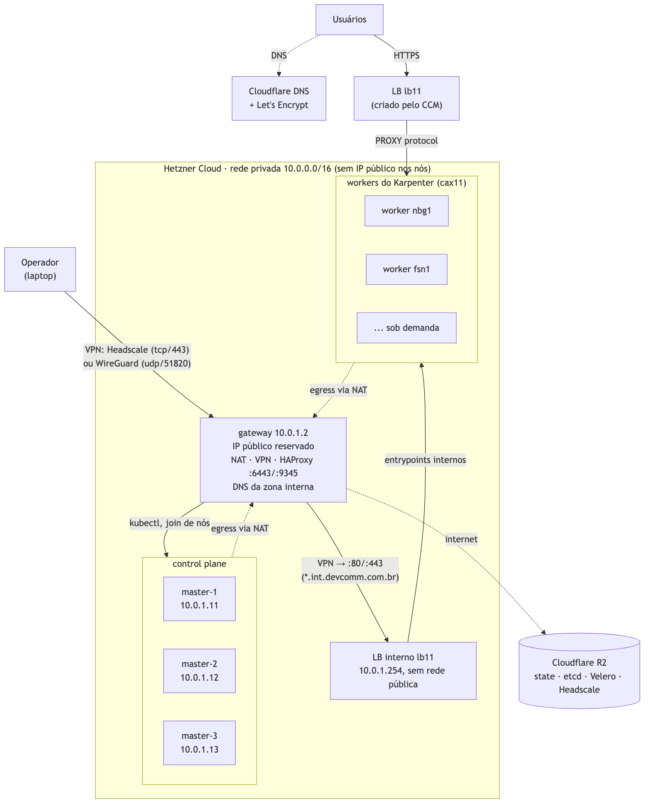
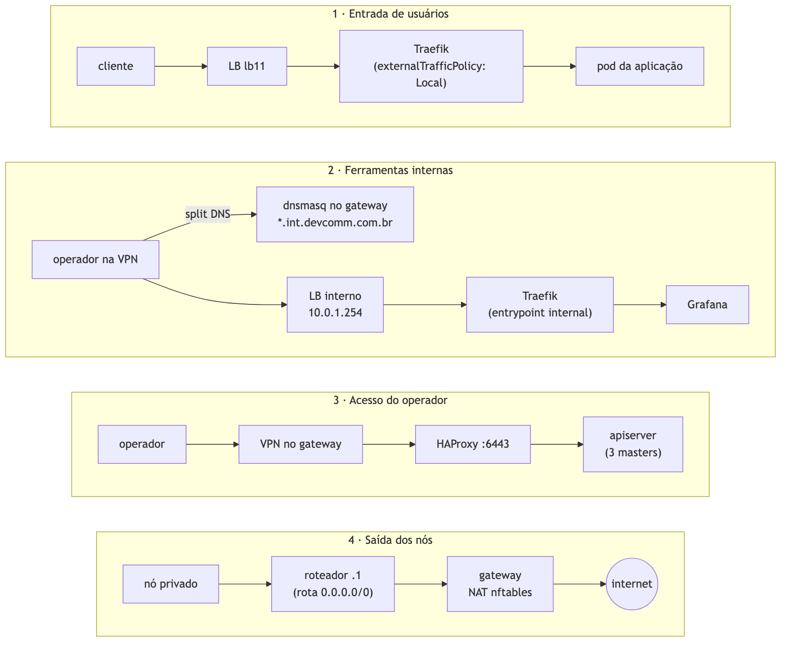
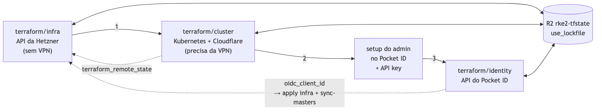

# Kubernetes production-ready por ~US$ 53/mês na Hetzner

Num EKS, GKE ou AKS, o control plane gerenciado, o NAT gateway e o load balancer custam mais do que muito cluster
inteiro antes de rodar a primeira aplicação. Neste post mostramos como montamos um cluster Kubernetes com cara de
produção na Hetzner Cloud, todo em Terraform, com custo fixo de cerca de **US$ 53/mês**.

Por "production-ready" queremos dizer:

- control plane em alta disponibilidade;
- workers que escalam sozinhos;
- nenhum nó exposto na internet;
- ingress público com TLS automático;
- backups, monitoramento e alertas;
- login com identidade no `kubectl` e na VPN.

## A arquitetura

Só um servidor, o **gateway**, tem IP público. Masters e workers vivem apenas na rede privada. O tráfego passa
por três caminhos:

## Quanto custa

Preços da API da Hetzner em outubro de 2026, em USD, sem IVA:

| Item | Mês |
|---|---|
| Gateway + 3 masters `cax11` (ARM, 2 vCPU, 4 GB) | US$ 27,96 |
| IPv4 do gateway | US$ 0,60 |
| Load balancer de ingress `lb11` | US$ 7,89 |
| 2 workers mínimos `cax11` | US$ 13,98 |
| Volumes (Prometheus, Alertmanager, Pocket ID) | US$ 3,07 |
| **Total fixo** | **US$ 53,50** |

Workers extras custam US$ 0,0112/hora cada e somem quando a carga cai. R2, Cloudflare DNS, Let's Encrypt,
Telegram e healthchecks.io cabem no plano gratuito.

O que mais reduziu o custo:

- **Nós sem IP público:** um IPv4 a menos por servidor.
- **Um gateway só** para NAT, VPN e endpoint do control plane.
- **HAProxy no lugar de um load balancer privado:** US$ 7,89/mês a menos.
- **ARM (`cax11`):** o tipo mais barato à venda que atende o mínimo do RKE2.
- **Karpenter com consolidação:** sem workers ociosos pagos.

## Os componentes

### Base

| Componente | Papel | Por quê |
|---|---|---|
| **Hetzner Cloud** | servidores, rede, LB, volumes | preço baixo, API completa e ecossistema para Kubernetes: CCM, CSI e um provider Karpenter |
| **RKE2** | distribuição Kubernetes | instala via cloud-init, etcd HA embutido, seguro por padrão; já traz Canal, CoreDNS e Traefik |
| **Ubuntu 24.04 em ARM (`cax11`)** | SO de todos os nós | mais barato; as imagens das aplicações precisam ser multi-arch |
| **Terraform** | tudo | três roots: `infra` (Hetzner), `cluster` (Kubernetes e Cloudflare) e `identity` (Pocket ID) |

### Rede e acesso

| Componente | Papel |
|---|---|
| **Rede privada da Hetzner** | os nós só têm interface privada; uma rota `0.0.0.0/0 → gateway` leva o egress até o NAT |
| **nftables no gateway** | NAT dos nós e firewall: entrada só pela VPN; a VPN alcança só SSH e apiserver |
| **HAProxy no gateway** | endpoint do control plane (`6443` e `9345`) com health check HTTPS dos três masters |
| **Headscale + Tailscale** | VPN do dia a dia, com login OIDC; o gateway é o subnet router da rede privada |
| **WireGuard** | VPN de emergência e caminho dos applies |
| **Litestream** | réplica contínua do banco do Headscale no R2, para o gateway poder ser recriado sem perder a VPN |

### Dentro do cluster

| Componente | Papel |
|---|---|
| **hcloud CCM** | inicializa os nós (`providerID hcloud://`) e cria o load balancer do ingress |
| **hcloud CSI** | volumes persistentes (`hcloud-volumes`) |
| **Karpenter** (provider comunitário da Hetzner) | cria workers para pods pendentes e remove os ociosos |
| **Traefik** (o do RKE2) | ingress, atrás do LB, com PROXY protocol e redirect para HTTPS |
| **external-dns** | cria os registros no Cloudflare a partir dos Ingress |
| **cert-manager** | certificados Let's Encrypt por DNS-01 |
| **kube-prometheus-stack** | métricas e alertas no Telegram, com dead man's switch |
| **Velero** | backup diário de objetos e volumes no R2 |
| **kured** | reinicia os nós, um por vez, depois de patches de kernel |
| **Pocket ID** | provedor OIDC com login por passkey, para o `kubectl` e a VPN |

## Os pontos importantes

Abaixo está o que faz diferença entre "funciona" e "dá para colocar produção em cima". Cada item custou algum
tempo para acertar.

### 1. Nenhum nó com IP público

A Hetzner não deixa anexar firewall a servidor sem IP público (`PrivateNetOnlyServer`). Isso não é um problema: o
isolamento vem justamente de **não existir interface pública**.

A pegadinha é o egress. Servidor só privado não recebe default route por DHCP, então o **primeiro** passo do
cloud-init de cada nó grava uma rota para o roteador da rede (`.1`) via netplan e espera o NAT responder antes de
baixar qualquer coisa.

### 2. O gateway concentra tudo, então trate-o com cuidado

VPN, NAT e endpoint do control plane no mesmo servidor economizam dinheiro, mas fazem dele um ponto único de falha
para acesso, egress e entrada de nós novos. Os nós que já estão no cluster continuam funcionando se ele cair.

Algumas regras que adotamos:

- **IP primário reservado:** o IPv4 sobrevive a um rebuild, e nenhum cliente VPN precisa ser reconfigurado.
- **O gateway nunca é recriado para mudar configuração.** Os arquivos mutáveis (WireGuard, nftables, HAProxy,
  Headscale) são enviados por um script que **valida no gateway antes de ativar** (`nft -c`, `haproxy -c`) e ativa
  sem derrubar túneis.
- **Fail-closed:** esse script roda em todo `terraform apply` que muda esses arquivos, e o apply falha se o envio
  falhar. Revogar um acesso à VPN nunca fica pendente em silêncio.
- **Host key SSH fixada** pelo Terraform: o script nunca confia no primeiro host que responder, porque envia a
  chave privada do WireGuard.
- **Descartável em vez de redundante:** as chaves do Headscale vêm do Terraform, e o banco dele (SQLite) é
  replicado continuamente para o R2 pelo Litestream. Um `terraform apply -replace=hcloud_server.gateway` traz o
  gateway de volta com o mesmo IP, as mesmas chaves e a tailnet restaurada. No teste levou cerca de 3 minutos, e os
  clientes Tailscale reconectaram sozinhos, sem novo login.

HA de verdade aqui seria um segundo gateway com keepalived e um Floating IP, movidos pela API da Hetzner, porque a
rede privada não tem VRRP. Custaria cerca de US$ 10/mês e poria um token com escrita no projeto inteiro dentro do
único host público. Para este cluster, alguns minutos de RTO compensam mais.

### 3. HAProxy no lugar do load balancer do control plane

Quem usa o endpoint `6443`/`9345`? O `kubectl`, que já passa pela VPN no gateway, e nós entrando no cluster, que já
dependem do gateway para baixar o RKE2. Agentes já registrados balanceiam sozinhos entre os masters. Ou seja, o
gateway já estava no caminho, e um LB pago não acrescentava disponibilidade.

Dois detalhes: o health check precisa ser HTTP (`/readyz` aceitando 401, porque a autenticação anônima está
desligada), e os timeouts precisam ser longos (1 h), senão `kubectl logs -f` cai.

### 4. Segredos fora do user_data

O metadata service da Hetzner (`169.254.169.254`) entrega o user_data do servidor a **qualquer processo no nó,
inclusive pods**. Por isso:

- **Dois tokens RKE2:** o de server fica só nos masters; os workers recebem só o `agent-token`.
- **O token da API da Hetzner** nunca vai para user_data. Ele é criado como Secret pelo Terraform, pela API do
  Kubernetes.
- **Uma política do Calico** (num tier próprio, antes do `default`) nega o egress de pods para
  `169.254.169.254`, com exceção do CSI, que precisa dele.

### 5. CCM e CSI sobem junto com o control plane

Com `cloud-provider-name: external`, os nós nascem com um taint `uninitialized` até um CCM inicializá-los. O CCM e o
CSI são instalados pelos **manifests de auto-deploy do RKE2**, gravados pelo cloud-init dos masters, e não pelo
Terraform do cluster.

Não esqueça `disable-cloud-controller: true`. Sem ele, o RKE2 grava um `providerID` `rke2://` imutável, e o
Karpenter não reconhece os nós.

### 6. Karpenter: o contrato dos workers

O provider comunitário funciona bem, mas exige alguns cuidados:

- **`capacity-type: on-demand` fixo no NodePool.** A Hetzner não tem spot, e sem esse pin a consolidação quebra.
- **O userData dos workers precisa** do taint `karpenter.sh/unregistered`, de `cloud-provider-name: external` e de
  um `kube-reserved` igual ao da NodeClass.
- **O controller roda nos masters**, porque não existe worker antes dele.
- **NodeClass e NodePool vão num chart Helm local.** O `kubernetes_manifest` precisa do CRD na fase de plan, e num
  cluster novo ele ainda não existe. Nesse chart, IDs numéricos precisam de `| int64` (senão saem como `1.2e+07`) e
  toda mudança de template exige subir a versão do chart.

### 7. Um mínimo de workers, em localizações diferentes

O Karpenter só cria nós para pods pendentes. Com pouca carga, o cluster encolheu para **um** worker, que concentrava
o único Traefik: a queda dele derrubava todo o ingress.

A solução foram **pods placeholder** (`pause`) com prioridade negativa: qualquer pod real os despeja, e o Karpenter
cria um nó novo para o placeholder despejado. Para que fiquem em localizações diferentes:

- **anti-afinidade obrigatória por zona**, não topology spread. O scheduler e o Karpenter só conhecem as zonas que
  já têm nós, e um spread se satisfaz com dois nós na mesma localização (aconteceu);
- **as localizações declaradas como zonas no NodePool**;
- **estratégia `Recreate`** no Deployment, porque um rolling update trava na anti-afinidade.

A consolidação usa budget de um nó por vez, para nunca remover todos os Traefik juntos.

### 8. Ingress com o IP real do cliente

O Traefik do RKE2 vira um Service `LoadBalancer`, e o CCM cria o LB. Em testes, **3 de 4 requisições perdiam o IP
real do cliente.** A causa era `externalTrafficPolicy: Cluster`: o kube-proxy fazia SNAT no salto entre nós. Com
`Local`, o LB só manda tráfego para nós com Traefik, e o IP real chega às aplicações.

Com external-dns e cert-manager, criar um Ingress com host e bloco `tls` já gera o registro DNS e um certificado
válido. Use DNS-01 (HTTP-01 conflita com o redirect para HTTPS), checagem de propagação em `1.1.1.1`/`8.8.8.8` e
teste primeiro com o issuer de staging do Let's Encrypt.

### 9. Pod Security `baseline` por padrão

Sem configuração, o RKE2 aceita pods privilegiados em qualquer namespace. Configuramos o apiserver com `enforce:
baseline` em todo o cluster, `restricted` em modo de aviso, e só o `kube-system` isento. Quem precisa de privilégio
(node-exporter, o agente do Velero) ganha um rótulo explícito no namespace, uma exceção visível no código.

### 10. Backups fora da Hetzner

- **Snapshots do etcd no R2**, a cada 6 h, com 7 dias de retenção. Restauram o control plane inteiro. Atenção: o
  restore exige o token de server da época do snapshot, que está no state do Terraform.
- **Velero no R2**, diário, com cópia dos volumes por arquivo. Recupera um namespace ou um volume sem voltar o
  cluster todo. Bancos de dados ainda precisam de dump próprio.
- **Litestream no R2**, contínuo, para o banco do Headscale no gateway: usuários e dispositivos da VPN voltam
  num rebuild.

Cada consumidor tem um token R2 próprio, com acesso a um bucket só, criado pelo Terraform. Os buckets têm
`prevent_destroy`.

### 11. Alertas que avisam quando tudo cai

kube-prometheus-stack com alertas no Telegram cobre nós, etcd, apiserver, volumes e workloads. Mas os alertas saem
pelo NAT do gateway: **se o gateway cair, nenhum alerta sai.** Por isso o alerta `Watchdog`, sempre ativo, pinga um
dead man's switch externo (healthchecks.io), que avisa quando os pings param.

O kured reinicia os nós depois de patches de kernel, um por vez, de madrugada.

### 12. Identidade: passkey no `kubectl` e na VPN

O kubeconfig admin do RKE2 é um certificado `cluster-admin` sem identidade e sem revogação individual. Hoje ele é
só o acesso de emergência.

- **Pocket ID** (um binário Go com SQLite, leve para `cax11`) é o provedor OIDC, com login só por passkey.
- **O apiserver** valida os tokens com `AuthenticationConfiguration`. O username é `oidc:`, porque email e
  username são editáveis, e o RBAC usa **só grupos**.
- **Headscale no gateway**, e não no cluster: a VPN é o caminho para consertar o cluster e não pode cair junto com
  ele. Entra quem está no grupo `vpn` do Pocket ID, e o login expira em 30 dias.
- **WireGuard estático continua** como break-glass.

Uma pegadinha: a Hetzner recusa uma rota de rede para `100.64.0.0/10` (a faixa da tailnet), então o tráfego da
tailnet sai com SNAT no gateway.

### 13. Terraform organizado em camadas

- **Três roots**, aplicados em ordem: `infra` só fala com a Hetzner e funciona sem VPN; `cluster` fala com o
  Kubernetes pela VPN; `identity` fala com a API do Pocket ID, cuja API key só existe depois do primeiro login.
- **State no Cloudflare R2** com o lock nativo do Terraform 1.10 (`use_lockfile`), sem DynamoDB. O R2 não tem
  versionamento, então um script guarda cópias do state depois de cada apply.
- **Proteção contra deleção da Hetzner** nos masters, no IP do gateway e na rede. Ela vale também para o console.
- **CI só estático** (`fmt`, `validate`, `tflint`, `trivy`, `helm lint`, `shellcheck`), sem nenhum segredo. Os
  applies rodam localmente, pela VPN, a partir de um plan revisado.
- **Versões fixadas**, inclusive o instalador do RKE2, conferido por sha256.

## Os limites desta abordagem

Um cluster assim não tem SLA de ninguém, e há riscos que vale aceitar de olhos abertos:

- **O gateway é ponto único de falha** para acesso, egress e entrada de nós novos. A mitigação é recuperação
  rápida (rebuild em minutos, sem perder a VPN), não redundância.
- **A disponibilidade de `cax` oscila.** Num mesmo dia, de manhã nenhum `cax` estava à venda, e à tarde voltou.
  Enquanto está esgotado, o Karpenter não cria workers, e substituir um master exigiria x86, a mais de três vezes
  o preço.
- **Os três masters ficam na mesma localização.** Os snapshots do etcd fora da Hetzner cobrem a perda dela, mas com
  restore manual.
- **Upgrades do RKE2 e do CCM/CSI** são manuais, porque os masters ignoram mudanças de user_data.
- **O provider Karpenter é comunitário**, com um token de poder total sobre o projeto. Versão fixada e upgrades
  revisados.

## Conclusão

Por cerca de US$ 53/mês temos três masters com etcd, workers elásticos, nenhum nó na internet, TLS automático,
backups fora do provedor, alertas que funcionam mesmo com o gateway fora do ar e login por passkey no `kubectl` e na
VPN. Nada disso exige serviços gerenciados caros. Exige conhecer as limitações do provedor e transformar cada
contorno em código.

Todas as decisões, com as alternativas descartadas, estão registradas como ADRs em [`docs/adr/`](../docs/adr/), e os
custos detalhados em [`docs/costs.md`](../docs/costs.md).

<!--
Diagramas: as fontes Mermaid estão em blog/diagrams/. Para renderizar de novo:
  for d in arquitetura fluxos terraform; do
    npx -y @mermaid-js/mermaid-cli@11.4.2 -i blog/diagrams/$d.mmd -o blog/images/$d.png -b white -s 2
  done
-->

