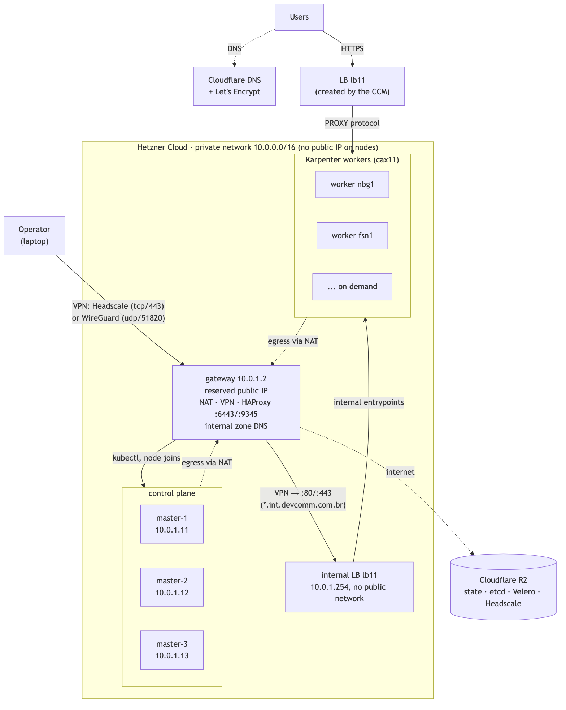
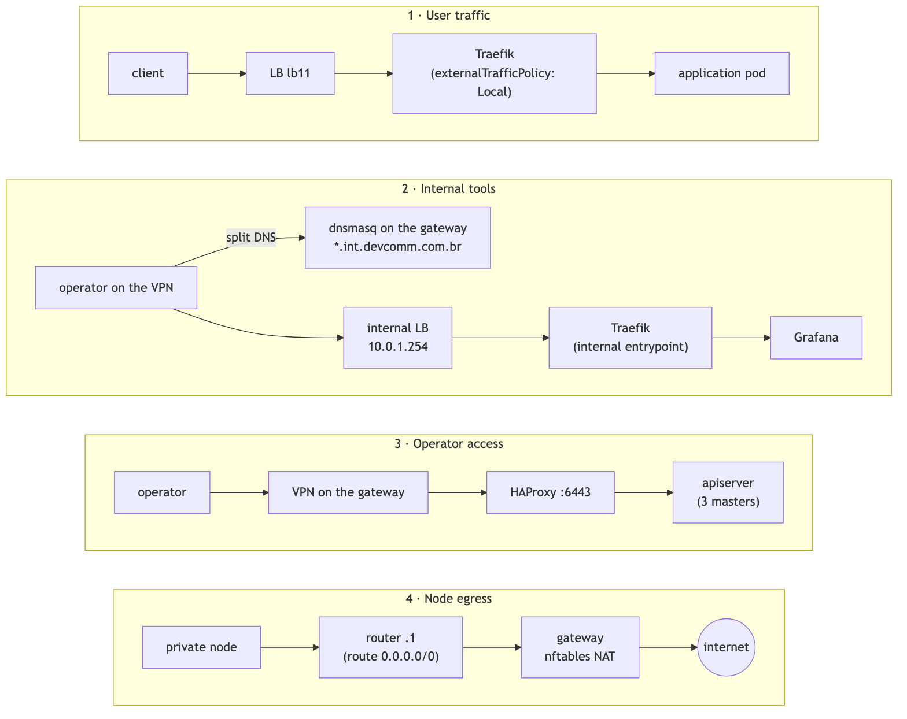
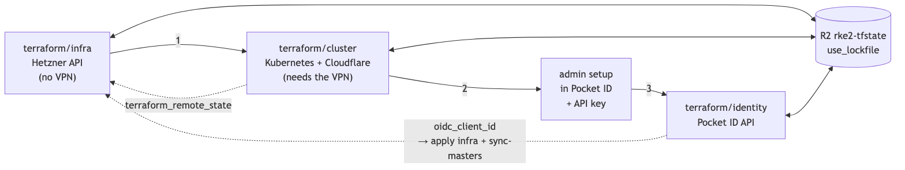

# Production-ready Kubernetes for ~$61/month: what I learned building a cluster on Hetzner

*A highly available control plane, workers that scale on their own, no node on the internet and passkey login, all
in Terraform and for less than what many big clouds charge for a NAT gateway.*

## Introduction

Anyone who has opened an EKS, GKE or AKS bill knows the feeling: before the first application is even running, the
managed control plane, the NAT gateway and the load balancer already cost more than many entire projects. For a
small team, an early-stage product or a serious lab, that cost floor hurts.

I wanted to find out what a cluster I would actually trust with production would cost, without giving up the
basics. To me, "production-ready" means:

- a highly available control plane;
- workers that scale on their own;
- no node exposed to the internet;
- public ingress with automatic TLS;
- internal tools, like Grafana, reachable only over the VPN;
- off-provider backups, monitoring and alerting;
- identity-based login for `kubectl` and the VPN, with no shared certificates.

The result is an RKE2 cluster on Hetzner Cloud, entirely in Terraform, with a fixed cost of **about $61 a month**.
In this article I explain how it is put together and, above all, the pitfalls that cost me time, because those are
what separate "it works" from "you can run production on it". All the code is open on GitHub:
[github.com/reginaldosousa/hetzner-rke2-terraform](https://github.com/reginaldosousa/hetzner-rke2-terraform).

## The build

### The architecture in one sentence

Only one server has a public IP: the **gateway**. Masters and workers live only on Hetzner's private network. The
gateway does NAT for the nodes' outbound traffic, terminates the VPN and serves as the control plane endpoint.
Users come in through a load balancer that Kubernetes itself creates.

In practice, traffic follows four paths: users through the public load balancer, internal tools over the VPN, the
operator over the VPN to the apiserver, and node egress through the gateway's NAT.

### What it really costs

Prices from the Hetzner API in October 2026, in US dollars, excluding VAT:

- **Gateway and 3 `cax11` masters** (ARM, 2 vCPU, 4 GB): $27.96
- **Gateway IPv4:** $0.60
- **Public load balancer** (`lb11`): $7.89
- **Internal load balancer** (`lb11`, private network only): $7.89
- **2 minimum `cax11` workers:** $13.98
- **Volumes** (Prometheus, Alertmanager, Pocket ID): $3.07
- **Fixed total: $61.39 a month**

Extra workers cost about one cent an hour and go away when load drops. Cloudflare R2, DNS, Let's Encrypt, Telegram
and healthchecks.io all fit in their free tiers.

What brought the cost down most: no public IP on any node, NAT, VPN and the control plane endpoint on a single
gateway, HAProxy on that gateway instead of a private load balancer, ARM machines, and Karpenter consolidating
idle workers.

### The stack, briefly

- **Hetzner Cloud** for servers, networking, load balancers and volumes: cheap, with a complete API and a CCM, a
  CSI driver and a Karpenter provider.
- **RKE2** as the distribution: installs from cloud-init, ships HA etcd and comes with Canal, CoreDNS and Traefik.
- **Terraform** for everything, in three layers: infrastructure, cluster and identity.
- **Headscale (Tailscale)** as the everyday VPN, with plain **WireGuard** as the emergency way in.
- **Karpenter** for workers; **Traefik**, **external-dns** and **cert-manager** for ingress; and
  **kube-prometheus-stack**, **Velero** and **kured** for operations.
- **Pocket ID** as the identity provider, with passkey-only login.

### Lesson 1: no node on the internet, but watch the egress

Hetzner doesn't even let you attach a firewall to a server without a public IP. That's fine: the isolation comes
precisely from there being no public interface.

The catch is getting out to the internet. A private-only server gets no default route over DHCP, so it can't
download anything. That's why the **first** step of every node's cloud-init writes a route to the network's router
and waits for the gateway's NAT to answer. Only then does it install RKE2.

### Lesson 2: the gateway concentrates everything, so it must be disposable

VPN, NAT and the control plane endpoint on one server save money, but they make it a single point of failure.
Nodes already in the cluster keep working if it goes down. What stops is access, outbound traffic and new nodes
joining.

Instead of HA, I chose to make the gateway **disposable**:

- Its public IP is reserved and survives a rebuild, so no VPN client needs to change anything.
- Configuration changes never require rebuilding the server. A script pushes the files, **validates them on the
  gateway itself** (`nft -c`, `haproxy -c`) and only then activates them, without dropping tunnels.
- That push runs on every `terraform apply` and is **fail-closed**: if it fails, the apply fails. Revoking
  someone's VPN access never stays silently pending.
- The gateway's SSH host key is pinned by Terraform. The script never trusts whichever host answers first, because
  it sends the WireGuard private key.
- Headscale's keys come from Terraform, and its database is continuously replicated to R2 by Litestream.

In testing, rebuilding the gateway took about 3 minutes, and VPN clients reconnected on their own, with no new
login. Real HA would need a second gateway and a token with write access to the whole project sitting on the only
public host. For this cluster, a few minutes of recovery is the better deal.

### Lesson 3: sometimes the paid load balancer adds nothing

Who uses the control plane endpoint? `kubectl`, which already comes through the VPN on the gateway, and nodes
joining the cluster, which already depend on the gateway to download RKE2. Agents that have already registered
load-balance across the masters on their own.

In other words, the gateway was already in the path, and a paid load balancer added no availability. HAProxy on
the gateway does the job, with two details: the health check has to be HTTPS (`/readyz` answers 401 because
anonymous auth is off), and timeouts have to be long, or `kubectl logs -f` drops.

### Lesson 4: the metadata service hands your secrets to any pod

Hetzner's metadata service gives the server's user_data to any process on the node, **pods included**. So:

- Masters hold RKE2's server token. Workers only get the `agent-token`, which grants no admin power.
- The Hetzner API token never goes into user_data. It reaches the cluster as a Secret, through Terraform.
- A Calico policy blocks pods from the metadata service, with an explicit exception for the volume driver.
- Pod Security is `baseline` across the cluster. Whatever needs privileges gets an exception that is visible in
  the code.

### Lesson 5: Karpenter works well, as long as you honor the contract

The community Hetzner provider created and removed workers without drama, but it has rules:

- The NodePool must pin `capacity-type: on-demand`, because Hetzner has no spot capacity, and without it
  consolidation breaks.
- The workers' user_data needs a specific taint, `cloud-provider-name: external` and resource reservations that
  match the NodeClass.
- NodeClass and NodePool go in a local Helm chart, because Terraform can't plan a resource whose CRD doesn't
  exist yet.

One case that caught me out: under light load, Karpenter shrank the cluster to **one** worker, which held the only
Traefik. Losing that node would take down all ingress. The fix was negative-priority placeholder pods, one per
location, with a required anti-affinity by zone. A topology spread wasn't enough: it was happy with two nodes in
the same location.

### Lesson 6: the client's real IP gets lost somewhere unexpected

Traefik becomes a LoadBalancer Service, and Kubernetes creates the load balancer on Hetzner. In testing, **3 out of
4 requests arrived without the client's real IP**. The culprit was `externalTrafficPolicy: Cluster`: kube-proxy
NATed the hop between nodes, and Traefik stopped trusting the PROXY header. With `Local`, the load balancer only
sends traffic to nodes that run Traefik, and the real IP reaches the applications.

With external-dns and cert-manager, a new Ingress gets a DNS record and a valid certificate with no manual step.

### Lesson 7: internal tools over the VPN only, with valid certificates

Grafana shouldn't be on the internet, but `kubectl port-forward` doesn't scale to several tools or to people
without a kubeconfig. I wanted `https://grafana.<something>` that only resolves and only answers over the VPN,
without registering a new domain and without a certificate warning in the browser.

- **No made-up domains.** An unregistered name under a public TLD can be bought by someone else, and then your
  bookmarks and cookies go to their server. `.internal` is reserved and safe, but no public certificate authority
  issues for it. I settled on a subdomain of a domain I already own, `int.devcomm.com.br`.
- **DNS over the VPN only.** dnsmasq on the gateway answers the zone's names, and Headscale hands that zone to
  clients. Public DNS has no records in it at all.
- **A load balancer with no public network**, in front of separate Traefik entrypoints.
- **A single Let's Encrypt wildcard certificate.** Public certificate logs show only the zone, not each tool's
  name.

The detail that matters most: Traefik routes by host name. An internal Ingress wired to the public entrypoints by
mistake would answer anyone who sent that name to the public IP. A Kubernetes admission policy rejects that
Ingress before it exists.

### Lesson 8: identity for `kubectl` and the VPN

RKE2's admin kubeconfig is a `cluster-admin` certificate with no identity and no individual revocation. Today it
only exists for emergencies.

- **Pocket ID**, a Go binary with SQLite, is the identity provider, with passkey-only login.
- The apiserver validates the tokens, and permissions are granted by group only.
- **Headscale runs on the gateway**, not in the cluster: the VPN is how you fix the cluster, so it can't go down
  with it. Anyone in the `vpn` group can get in, and the login expires after 30 days.

### Lesson 9: off-provider backups and alerts that fire when everything is down

- etcd snapshots to R2 every 6 hours, to recover the whole control plane.
- Daily Velero backups to R2, to recover one namespace or one volume without rolling back the whole cluster.
- Continuous Litestream replication for the VPN's database.

Each one has its own token, with access to a single bucket.

Alerts go to Telegram, but they leave through the gateway's NAT: **if the gateway is down, no alert gets out**.
That's why an always-firing alert pings an external service (a dead man's switch), which tells me when the pings
stop.

### Lesson 10: Terraform in layers, with as little magic as possible

- Three layers applied in order: infrastructure talks only to Hetzner, the cluster layer talks to Kubernetes over
  the VPN, and the identity layer talks to Pocket ID's API.
- State lives in Cloudflare R2, with Terraform's native locking and no extra database.
- Delete protection on the masters, the gateway's IP and the network.
- CI is static only, with no secrets. Applies run locally, over the VPN, from a reviewed plan.
- Pinned versions, including the RKE2 installer, checked by hash.

### The limits, honestly

A cluster like this comes with nobody's SLA. These are the risks I accepted with my eyes open:

- The gateway is still a single point of failure. The mitigation is fast recovery, not redundancy.
- ARM availability fluctuates. On a single day, there were none for sale in the morning, and they were back in the
  afternoon.
- All three masters are in the same location. Snapshots outside Hetzner cover losing it, but with a manual
  restore.
- RKE2 upgrades are manual.
- The Karpenter provider is a community project and uses a token with full power over the project.

## Conclusion

For about $61 a month, this cluster has three masters with etcd, elastic workers, no node on the internet,
automatic TLS, internal tools reachable only over the VPN, off-provider backups, alerts that work even with the
gateway down, and passkey login for `kubectl` and the VPN.

None of it required expensive managed services. It required knowing the provider's limits and turning every
workaround into code: the route that must exist before the first download, the token that can't go into
user_data, the load balancer that added nothing, the policy that keeps a configuration mistake from exposing an
internal tool.

If I had to sum it up in one lesson: **low cost and production are not opposites, as long as every decision is
written down**. Every choice in this project, along with the alternatives I ruled out, is documented as an ADR
(Architecture Decision Record) next to the code, at [github.com/reginaldosousa/hetzner-rke2-terraform](https://github.com/reginaldosousa/hetzner-rke2-terraform).

What about you: have you run Kubernetes outside the big clouds? Which pitfall cost you the most time?

<!--
Published at: https://reginaldosousa.com/production-ready-kubernetes-for-61-month-what-i-learned-building-a-cluster-on-hetzner-cb7deda67048
English version of kubernetes-production-ready-baixo-custo.md; keep both in step.
Format: written for Medium and LinkedIn, which don't render Markdown tables, so lists only.
Diagrams: Mermaid sources in blog/diagrams/en/. To re-render:
  for d in architecture flows terraform; do
    npx -y @mermaid-js/mermaid-cli@11.4.2 -i blog/diagrams/en/$d.mmd -o blog/images/en/$d.png -b white -s 2
  done
Technical details and costs: docs/adr/, docs/costs.md.
-->
