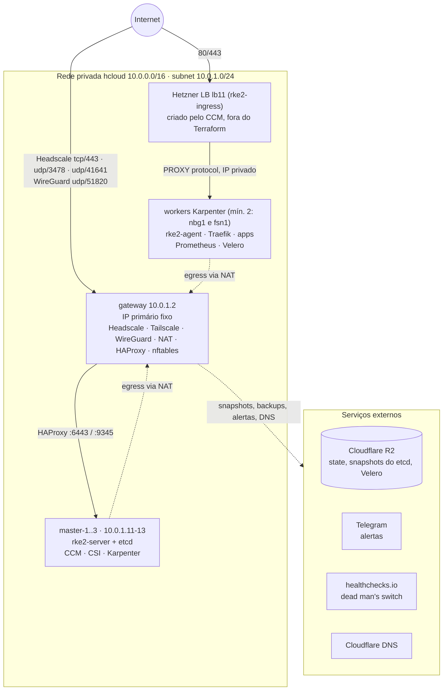
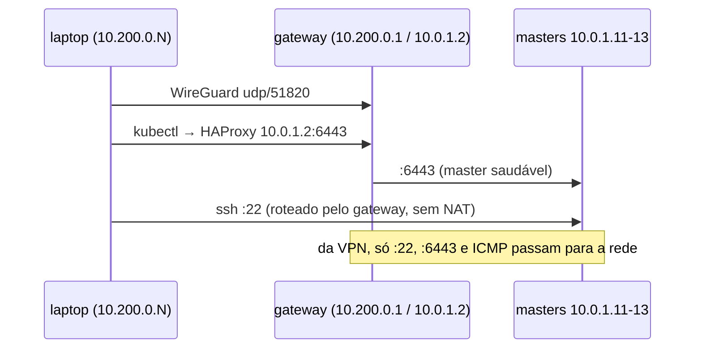
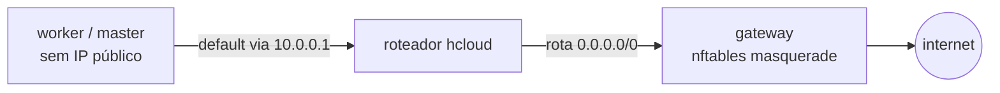
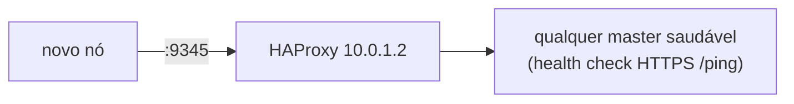
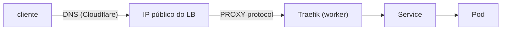
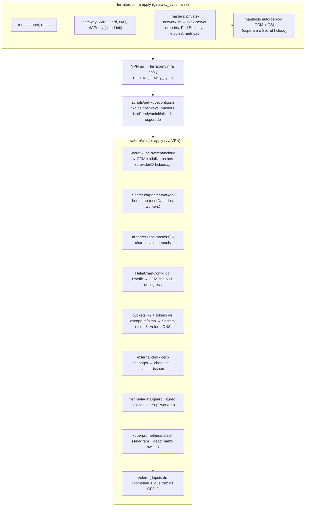

# Arquitetura

## Visão geral

Somente dois pontos recebem tráfego da internet:

1. **Gateway**: o firewall da Hetzner e o nftables do próprio gateway aceitam da internet o Headscale
   (`tcp/443`, `udp/3478`, `udp/41641`) e o WireGuard (`udp/51820`). SSH e kubectl passam por um dos túneis
   ([ADR 0025](adr/0025-headscale-oidc-vpn.md)).
2. **Load Balancer de ingress**: criado pelo hcloud CCM a partir do Service do Traefik. Encaminha 80/443 para os
   workers pela rede privada.

## Endereçamento

Os IPs fixos são calculados com `cidrhost` em `terraform/infra/network.tf`:

| Endereço | Quem | Observação |
|---|---|---|
| `10.0.0.1` | roteador virtual da Hetzner | `cidrhost(network_cidr, 1)`, default route dos servidores privados |
| `10.0.1.2` | gateway | também é o endpoint do control plane (`local.control_plane_ip`) |
| `10.0.1.11`–`.13` | master-1..3 | `local.master_ips`, que gera o backend do HAProxy |
| `10.0.1.x` | workers | DHCP, criados pelo Karpenter |
| `10.200.0.1` | gateway (`wg0`) | |
| `10.200.0.N` | clientes VPN | `N` fixo por cliente em `vpn_clients` |
| `10.42.0.0/16`, `10.43.0.0/16` | pods / services do RKE2 | as variáveis validam que nada sobrepõe estas faixas |

Rotas da rede hcloud:

- `0.0.0.0/0 → 10.0.1.2`: egress dos servidores privados sai pelo NAT do gateway. Conexões da rede para os
  clientes VPN são recusadas.
- `10.200.0.0/24 → 10.0.1.2`: caminho de volta para os clientes VPN (roteado, sem NAT).

## Fluxos de tráfego

### Operador → cluster

O `kubeconfig` gerado por `scripts/get-kubeconfig.sh` aponta para `https://10.0.1.2:6443`. O IP está no
`tls-san` dos masters. Da VPN, o gateway só encaminha SSH (`22`), apiserver (`6443`) e ICMP para a rede.
`kubectl exec`, `logs` e `port-forward` (Grafana, Prometheus) passam pelo apiserver. O SSH nos masters usa as
host keys de `master_known_hosts` (`scripts/pin-master-host-keys.sh`).

### Nó privado → internet (egress)

Servidores sem IP público não recebem default route por DHCP. `templates/private-network.sh.tftpl` grava uma
rota via netplan **antes** de qualquer download e espera o NAT responder.

### Join de nós

Depois do join, o agente RKE2 balanceia sozinho entre os masters. O HAProxy só é necessário para kubectl e para
nós entrando no cluster.

### Usuário → aplicação (ingress)

- `externalTrafficPolicy: Local`: o LB só entrega para nós que rodam Traefik, evitando o salto do kube-proxy
  que faria SNAT e invalidaria o cabeçalho PROXY.
- O Traefik confia em PROXY protocol apenas vindo de `network_cidr`.
- HTTP recebe 308 para HTTPS no entrypoint `web`.

## Ordem de bootstrap

Mudanças futuras nos drop-ins dos masters não passam pelo cloud-init (os masters ignoram `user_data`): depois do
apply do `infra`, rode `scripts/sync-masters.sh`.

## Ciclo de vida de um worker

1. Um pod fica `Pending` por falta de capacidade.
2. O Karpenter escolhe um tipo `cax` em `nbg1`/`fsn1`, `on-demand`, e cria o servidor com o userData do Secret
   `karpenter-worker-bootstrap`.
3. O cloud-init roda `private-network.sh`, confere o sha256 do instalador, instala `rke2-agent` na versão
   `rke2_version` e entra via `10.0.1.2:9345` usando o **agent token**.
4. O nó nasce com o taint `karpenter.sh/unregistered:NoExecute`. O CCM define `providerID: hcloud://<id>`, e o
   Karpenter associa a NodeClaim e remove o taint.
5. Quando o nó fica vazio ou subutilizado por 5 minutos, a consolidação o remove, um nó por vez. Os pods
   placeholder seguram um worker por localização, e cada worker é trocado depois de 30 dias (`expireAfter`).
6. O kured reinicia o nó entre 01:00 e 05:00 quando o unattended-upgrades instalou um patch que pede reboot.

## Contratos entre arquivos

Algumas coisas precisam continuar alinhadas entre arquivos diferentes:

| Contrato | Onde |
|---|---|
| `kube-reserved` do kubelet | `worker-userdata.yaml.tftpl` ↔ `spec.kubelet` em `charts/nodepools/templates/nodeclass.yaml` |
| `cloud-provider-name: external` | userData de masters e workers. Nos masters também `disable-cloud-controller: true` |
| Mesma versão de RKE2 | masters e workers usam `rke2_version`, e `rke2_install_sha256` é o hash do `install.sh` dessa tag |
| Drop-ins do RKE2 nos masters | `local.master_files` → output `master_config_files` → `scripts/sync-masters.sh` |
| Nome do Secret do etcd-s3 | output `etcd_s3_config_secret` do `infra` ↔ `kubernetes_secret_v1.etcd_s3` no `cluster` |
| `version` do `Chart.yaml` local | aumentar a cada mudança de template, senão o provider Helm não vê a mudança |
| `min_workers` ≤ número de `worker_locations` | um placeholder por localização (anti-afinidade obrigatória) |
| Outputs do root `infra` | lidos por `terraform/cluster/main.tf` via `terraform_remote_state` |
| `capacity-type: on-demand` | NodePool. A Hetzner não tem spot |
| `HCLOUD_INSTANCES_ZONE_LABEL_ENABLED=false` | CCM deixa o label de zona para o Karpenter |
